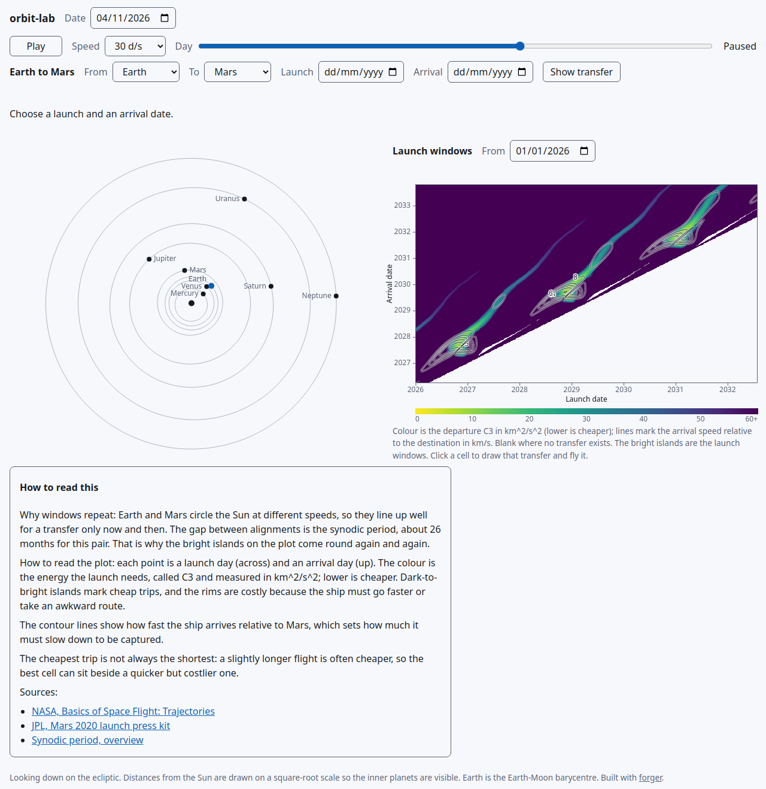
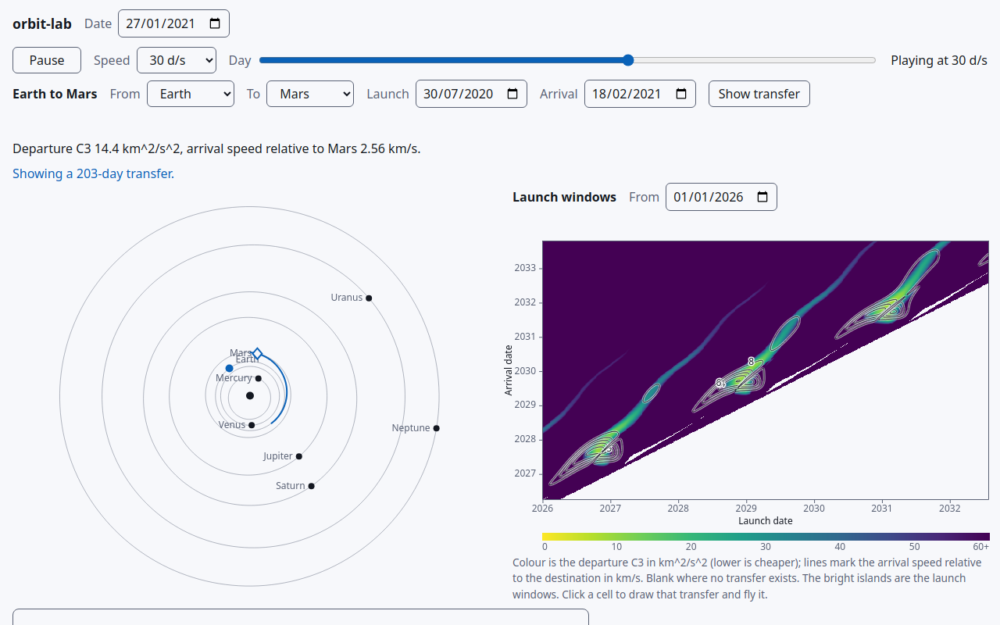
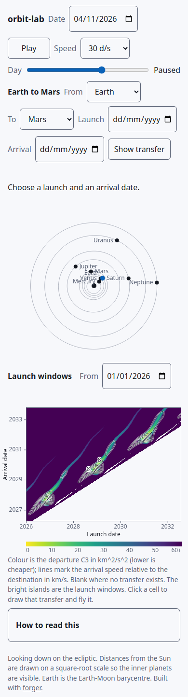

# orbit-lab

See the solar system on any date and find the launch windows to other planets.

> Built with [forger](https://github.com/diegoaltoworks/forger), an unattended development loop: every change here came from an issue, was built by an agent on its own branch, and merged only after the gates, CI and an independent verifier passed. See the [forger README](https://github.com/diegoaltoworks/forger#readme) for how it works.

<picture>
  <source media="(prefers-color-scheme: dark)" srcset="docs/screenshots/index-desktop-dark.png">
  
</picture>

## The story

Pick any date between 1900 and 2100 and the page draws the eight planets where they really were, from published orbital elements. Press play and watch them move.

Then ask the question mission planners ask: when should a spacecraft leave? For every pair of launch and arrival dates the page solves Lambert's problem, the orbit that joins two points in a given time, and colours the plot by the energy the launch needs. The bright islands, about one per synodic period, are the launch windows. This is the porkchop plot.

Click a cell and the transfer is drawn in the solar system view and flown from the origin planet to where the destination will be on arrival.

<picture>
  <source media="(prefers-color-scheme: dark)" srcset="docs/screenshots/trip-desktop-dark.png">
  
</picture>

The plot is checked against real launches, any pair of planets can be chosen, and a plain-words panel explains how to read it. It works on a phone and in light and dark.

<picture>
  <source media="(prefers-color-scheme: dark)" srcset="docs/screenshots/index-phone-dark.png">
  
</picture>

All the maths runs in the browser and nothing is fetched at run time.

## Read more

- [docs/brief.md](docs/brief.md): the owner's brief.
- [docs/research](docs/research/): the evidence behind each choice (ephemeris, Lambert, rendering, validation, explanation).
- [docs/adr](docs/adr/): the decisions taken from that evidence.
- [docs/plan.md](docs/plan.md): the build order, one visible slice at a time.

A forger work loop builds it: requests are GitHub issues labelled `ready-for-agent`, each is built on its own branch, and a PR merges only when the gates in `.forger/workloop.config.json`, CI and an independent verifier pass.

## Develop

```
bun install
bun run start
bun run check
```

## Deploy

`bun run build` writes the static site to `dist/` (git-ignored): everything in `public/` plus each browser entry point, bundled and minified at the same path the dev server uses. The entry points are listed once, in `src/entries.ts`, and shared by the build and `bun run start`.

`vercel.json` configures a Vercel project linked to this repository to install, run the build and serve `dist/`, so every merge to main deploys with no server code.
